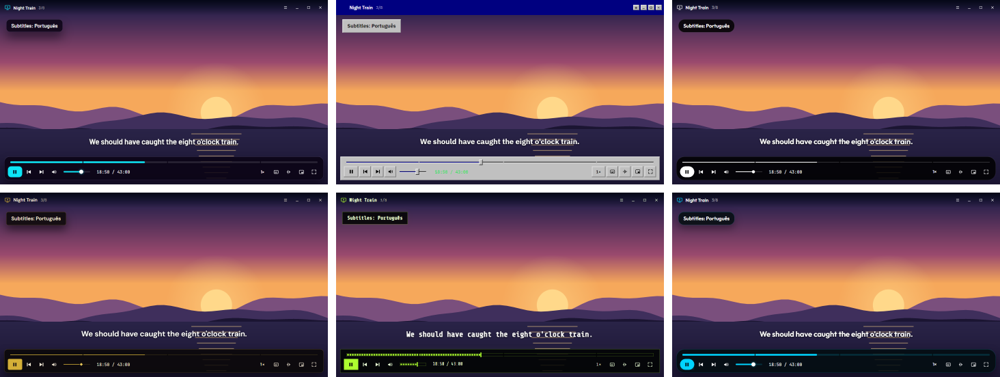
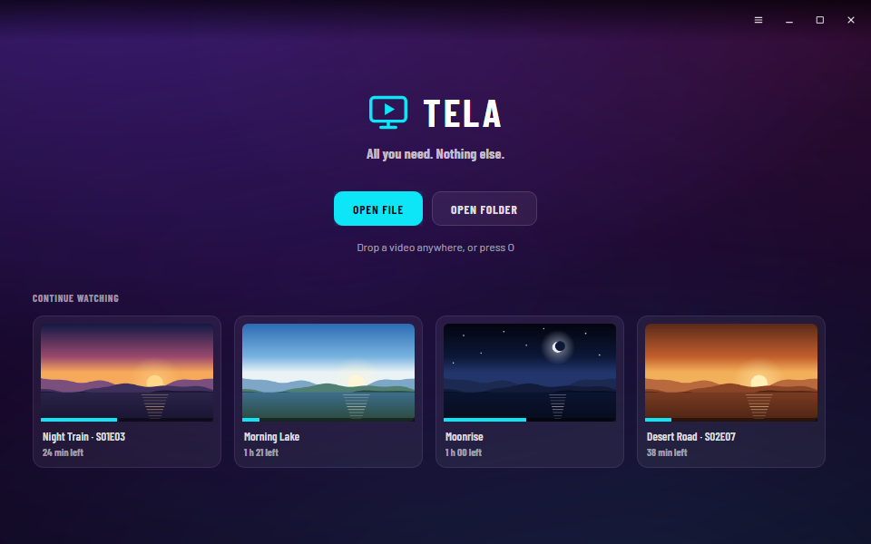

<p align="center">
  
</p>

<h1 align="center">Tela</h1>

<p align="center">
  <b>Tudo o que precisa. Nada mais.</b><br>
  Um leitor de vídeo para Windows e Linux.<br>
  <sub>by zimutek</sub>
</p>

<p align="center">
  <a href="README.md">Read me in English</a> · Windows 10 / 11 · Linux · .NET 10 · libmpv · MIT
</p>

<p align="center">
  <a href="https://github.com/zimutes/tela/actions/workflows/compilar.yml"></a>
</p>

<p align="center">
  
</p>

---

> **Testada** no Windows 11 (descodificação pela placa, por D3D11) e no Fedora 44 sem placa
> gráfica (desenho por software), com H.264, HEVC, MPEG-4, AAC, MP3, legendas embutidas e em
> ficheiro, várias faixas de áudio e capítulos.
>
> Partilhada tal como está, **sem garantia de espécie nenhuma**: ver a [LICENSE](LICENSE).

---

## Porquê

O VLC toca tudo e mostra tudo: menus dentro de menus, barras de ferramentas, definições em que
nunca se toca. A Tela toca tudo também, com o motor do mpv, e depois sai da frente: a imagem
enche a janela, os controlos flutuam por cima e somem enquanto se vê, e o que é preciso de
verdade está a uma tecla ou a um clique. É da mesma família da [Fita](https://github.com/zimutes/fita),
o leitor de música: os mesmos seis temas, o mesmo "by zimutek".

<p align="center">
  
</p>

## O que faz

- **Toca quase tudo**, com a libmpv (o motor do mpv) e o FFmpeg: MKV, MP4, MOV, AVI, WebM,
  WMV, FLV, MPEG-TS, VOB e mais; H.264, HEVC, AV1, VP9, MPEG-2/4; o HDR é convertido para o
  ecrã. **Descodifica pela placa gráfica** quando ela consegue, e por software quando não.
- **Continua onde ficou.** Cada vídeo lembra-se da posição, das faixas de áudio e de legendas
  escolhidas e dos atrasos acertados. O ecrã inicial mostra o *Continuar a ver*, com uma imagem
  de onde parou e quanto falta.
- **Pensa em séries.** Abrir um episódio traz a pasta com ele, pela ordem natural (o E2 antes do
  E10). Perto do fim, um cartão conta até ao episódio seguinte (*Ver já* / *Cancelar*). As
  línguas escolhidas para o áudio e as legendas passam para o episódio seguinte.
- **Legendas como deve ser:** o `.srt` com o mesmo nome ao lado do vídeo (ou numa pasta `Subs`)
  abre sozinho; faixas embutidas, forçadas, língua preferida, tamanho, uma caixa escura por trás
  para cenas claras, atraso em passos de 100 ms, e largar um ficheiro de legendas na janela
  junta-o. As legendas sobem quando os controlos aparecem, para nunca ficarem por trás deles.
- **A imagem é a janela.** Abre com a forma do vídeo (sem barras pretas); os controlos flutuam
  por cima e somem com o cursor enquanto toca; duplo clique para ecrã inteiro; arrastar a
  imagem move a janela; uma mini-janela sempre por cima, num canto (`I`).
- **Barra de posição com pré-visualização:** passar o rato mostra uma imagem desse momento e o
  nome do capítulo; os capítulos cortam a barra em segmentos; a arrastar vai-se vendo, ao largar
  cai no ponto exato.
- **Tudo o que é essencial, nada a mais:** velocidade (0,25× a 4×, sem mudar o tom), imagem a
  imagem, repetir de A a B, repetir o vídeo, proporção, cortar para encher, rodar,
  desentrelaçar, capturas (com ou sem legendas), saída de som, nivelar o volume (para filmes
  em que os sussurros e as explosões vivem a 30 dB de distância), volume até 150%, informação
  técnica.
- **Não deixa o ecrã apagar** enquanto há vídeo a tocar (e só aí).
- **Teclado e rato:** teclas do mpv, do VLC e do YouTube (em baixo); roda para o volume, os
  botões laterais do rato para ±10 s, botão direito para o menu completo, botão do meio para
  tirar o som.
- **Seis temas**, os mesmos da Fita (do painel do Jazmin, o CMS do autor): Purple Haze, 1995
  Calling, Midnight OLED, Boutique Gold, Toxic Terminal e Oceanic Flow. Mudam as fontes, as
  formas e o relevo, não só as cores.
- **Uma só janela:** abrir um ficheiro com a Tela já aberta toca-o nela. No Windows, *Abrir com*
  nos ficheiros de vídeo e, no botão direito de uma pasta, *Ver na Tela*.
- **Funciona também sem placa gráfica:** se não houver OpenGL (máquinas virtuais, ambientes
  remotos, controladores avariados), o vídeo é desenhado por software, sozinho. Se alguma vez a
  imagem ficar preta, *Definições → Desenhar o vídeo por software* faz o mesmo de propósito.
- **Inglês ou português.**

### Teclas

| Teclas | |
|---|---|
| `Espaço` · `K` · clique | Tocar / pausa |
| `←` `→` · `J` `L` | Recuar / avançar 5 s · 10 s |
| `Shift+←` `→` · `,` `.` | 1 s · imagem a imagem |
| `0`–`9` · `Home` | Saltar para 0–90% · para o início |
| `PgUp` `PgDn` | Capítulo anterior / seguinte |
| `↑` `↓` · `M` · roda | Volume · sem som |
| `F` · duplo clique · `Esc` | Ecrã inteiro · sair |
| `I` · `T` | Mini-janela · sempre por cima |
| `N` · `P` | Vídeo seguinte / anterior da pasta |
| `V` · `B` | Legendas seguintes · faixa de áudio seguinte |
| `Z` `X` · `Shift+Z` `X` | Atraso das legendas · do som (−/+ 100 ms) |
| `G` `H` | Legendas mais pequenas / maiores |
| `[` `]` · `Backspace` | Mais devagar / mais depressa · velocidade normal |
| `R` · `Shift+R` | Repetir um troço (A, B, parar) · repetir o vídeo |
| `A` · `C` · `D` | Proporção · cortar para encher · desentrelaçar |
| `S` · `Shift+S` | Captura · sem legendas |
| `Shift+I` | Informação técnica |
| `Ctrl+O` · `Ctrl+Shift+O` · `Ctrl+V` | Abrir ficheiro · pasta · colar um ficheiro ou caminho copiado |
| `Ctrl+W` · `Ctrl+Q` · `F1` | Fechar o vídeo · sair · todas as teclas |

## O que é preciso

- **Windows 10 ou 11 (x64)**: mais nada. A libmpv vem com a Tela (a `libmpv-2.dll`, ao lado do
  `Tela.exe`).
- **Linux (x64 ou arm64)** com X11 ou XWayland, e a **libmpv** da sua distribuição:
  `sudo dnf install mpv-libs` (Fedora), `sudo apt install libmpv2` (Debian/Ubuntu),
  `sudo pacman -S mpv` (Arch). No Fedora, o `ffmpeg-free` que vem por omissão toca H.264 (pelo
  OpenH264) mas não HEVC (H.265): para isso, troque pelo FFmpeg do RPM Fusion
  (`sudo dnf swap ffmpeg-free ffmpeg --allowerasing`). A Tela avisa quando não consegue
  descodificar o formato de um vídeo, em vez de mostrar uma imagem preta.
- Para compilar: o [.NET 10 SDK](https://dotnet.microsoft.com/download/dotnet/10.0).

## Instalar

### Descarregar

Da [versão mais recente](https://github.com/zimutes/tela/releases/latest):

| Ficheiro | Para |
|---|---|
| `Tela-autonomo-win-x64.zip` | Windows 10/11 (x64). Autónomo: descomprimir onde quiser e abrir o `Tela.exe` (com a `libmpv-2.dll` ao lado). |
| `Tela-win-x64.zip` | Windows 10/11 (x64), mais pequeno. Precisa do [runtime .NET 10](https://dotnet.microsoft.com/download/dotnet/10.0). |
| `Tela-linux-x64.tar.gz` · `Tela-linux-arm64.tar.gz` | Linux. Autónomo; instale a libmpv (ver acima) e depois `tar -xzf Tela-linux-x64.tar.gz && ./tela/instalar.sh` |

Os ficheiros não estão assinados: o SmartScreen do Windows pode perguntar primeiro (*Mais
informações → Executar mesmo assim*). As somas de verificação estão em `SHA256SUMS`. Para ter a
Tela no menu Iniciar, no *Abrir com* e o *Ver na Tela* no Windows, use antes o instalador de baixo.

### Compilar a partir do código

**Windows** (PowerShell):

```powershell
git clone https://github.com/zimutes/tela
cd tela
.\tools\publicar.ps1              # descarrega a libmpv, compila e instala para o utilizador atual
.\tools\publicar.ps1 -Autonomo    # autónomo, sem precisar do .NET instalado
.\tools\publicar.ps1 -SemMenus    # sem a entrada no botão direito das pastas
```

Fica em `%LOCALAPPDATA%\Programs\Tela`, com a **Tela** no menu Iniciar e no *Abrir com* dos
ficheiros de vídeo (e nas *Aplicações predefinidas* do Windows, sem passar a ser a
predefinida) e (a não ser com `-SemMenus`) *Ver na Tela* no botão direito das pastas. Não
precisa de permissões de administrador. Para remover: `.\tools\desinstalar.ps1` (`-Tudo` apaga
também as definições e o histórico, `-WhatIf` mostra o que faria).

**Linux**:

```sh
git clone https://github.com/zimutes/tela
cd tela
./tools/instalar.sh               # compila e instala para o utilizador atual
./tools/instalar.sh --remover     # remove
```

Fica em `~/.local/opt/tela`, com o comando `tela` em `~/.local/bin` e uma entrada no menu de
aplicações (com *Abrir com* para ficheiros de vídeo), e avisa se faltar a libmpv.

## Como funciona

- **Motor:** a libmpv, por uma ligação pequena e nossa à API em C (`src/Tela/Mpv`). Uma thread
  espera pelos eventos do mpv; as mudanças de propriedades chegam à interface na thread dela; a
  posição, que muda a cada imagem, lê-se quando é precisa em vez de a inundar.
- **Imagem:** o mpv desenha pela API de desenho em OpenGL diretamente no framebuffer que o
  Avalonia dá ao controlo do vídeo, e o resto da interface desenha-se por cima, sem "buracos" de
  janelas nativas: é isso que deixa os controlos, a pré-visualização e as mensagens flutuarem
  por cima da imagem. Sem OpenGL, a API de desenho por software do mpv desenha cada imagem num de
  três bitmaps, numa thread própria.
- **Miniaturas:** uma segunda libmpv, calada (sem som, sem legendas, sem placa gráfica), salta
  para a imagem-chave mais próxima e desenha uma imagem pequena em memória, para a barra de
  posição e para o *Continuar a ver*.
- **Interface:** Avalonia, com os controlos que importam desenhados à mão para os temas poderem
  mudar a forma e não só a cor.

## Segurança

A Tela abre ficheiros que não fez, com o mpv e o FFmpeg, por isso:

- **Sem configuração do utilizador, sem scripts, sem youtube-dl.** Nunca lê um `mpv.conf` nem
  corre scripts Lua que estejam instalados para o mpv, e nunca vai buscar nada à internet.
- **Só ficheiros locais.** Os formatos que abrem outros ficheiros por dentro (HLS, concat) só
  podem abrir ficheiros locais, nunca endereços; listas de reprodução dentro de ficheiros não se
  seguem (abra os vídeos ou a pasta deles). Um ficheiro disfarçado de vídeo é recusado.
- **Uma só instância, só do utilizador:** o pipe que passa os ficheiros à janela aberta só aceita
  ligações do mesmo utilizador.
- Sem rede, sem telemetria, sem permissões de administrador. As definições e o histórico ficam em
  `%APPDATA%\Tela` (Windows) ou `~/.config/tela` (Linux), e os erros em `log.txt`, lá dentro.

## Compilar

```sh
dotnet build Tela.slnx -c Release
dotnet test tests/Tela.Tests
```

No Windows, o `tools/obter-libmpv.ps1` descarrega a libmpv fixada (conferida pela soma SHA-256)
para `lib/win-x64/`; a compilação copia-a para o lado do `Tela.exe`.

- `src/Tela/Mpv/`: a ligação à libmpv (`Native`), o leitor e os eventos (`MpvPlayer`), as
  miniaturas (`Thumbnailer`).
- `src/Tela/Controls/`: o vídeo (`VideoView` em OpenGL, `SoftwareVideoView` sem), os controlos de
  deslizar, ícones e fundos desenhados à mão.
- `src/Tela/Library/`: que ficheiros abrem e por que ordem (`MediaFiles`), a lista (`PlayQueue`),
  onde ficou cada vídeo (`History`).
- `src/Tela/Views/`: a janela, dividida por áreas (leitor, janela e teclas, camada por cima,
  menus, ecrã inicial).
- `src/Tela/Loc.cs`: todos os textos da interface, em inglês e em português.
- `Tela --selftest ficheiro…` passa ficheiros pela libmpv sem janela (abre, toca, salta, lê faixas
  e capítulos, tira uma miniatura).
- `tools/Capturas` desenha a janela em cada tema sem ecrã (as imagens de cima).
- Uma etiqueta `v*` faz o GitHub Actions publicar uma versão (Windows e Linux) com `SHA256SUMS`.

## Licença

[MIT](LICENSE) © zimutek. As partes de terceiros (libmpv, FFmpeg, Avalonia, as fontes) mantêm as
licenças delas: ver [THIRD-PARTY-NOTICES.md](THIRD-PARTY-NOTICES.md).
